# 🧠 One-Shot Learning on CIFAR-100 with Siamese Networks

Can a model recognise a class it has **never seen during training**, from **a single example**?

This project trains a **Siamese network** (PyTorch, pretrained ResNet-18 backbone) to tell whether two images belong to the same class. It then uses that skill to classify images from **completely new classes** by comparing each one against a single labelled example per class (**N-way 1-shot classification**).

[](https://colab.research.google.com/github/bassemr/one-short-learning/blob/main/notebooks/One_shot_learning_with_Cifar100_dataset.ipynb)

---

## ✨ Highlights

- **41.8% accuracy on 10-way 1-shot** classification of unseen classes, **4× better than random guessing** (10%)
- **7× better than chance on 50-way 1-shot** (14.6% vs 2%)
- **13 logged training runs** comparing backbones (pretrained ResNet-18 vs CNN from scratch), losses (BCE vs contrastive), fine-tuning strategies, dataset sizes and similarity metrics
- Modular, reusable PyTorch code: data pipeline, models, training with early stopping, TensorBoard logging and three evaluation methods

---

## 🎯 The Task

**Training (seen classes):** the network learns a single skill, *"are these two images from the same class?"*, from thousands of positive (same class) and negative (different class) image pairs.

**Testing (unseen classes):** for classes the model has never seen, we give it a **support set** with **one image per class**. Each new **query** image is compared to every support image, and it is assigned the class of the most similar one.

<p align="center">
  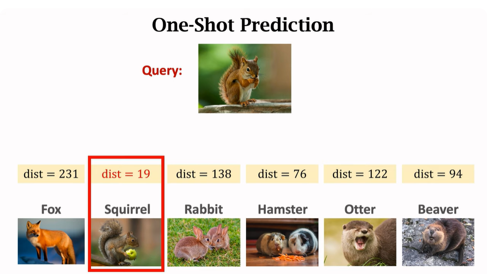
</p>

The difficulty depends on how many classes the query must be told apart from:

| Classes split (seen / unseen) | Test task | Random guess |
|:---:|:---:|:---:|
| 90 / 10 | 10-way 1-shot | 10% |
| 80 / 20 | 20-way 1-shot | 5% |
| 50 / 50 | 50-way 1-shot | 2% |

---

## ⚙️ Method

### Data pipeline
1. Download the CIFAR-100 train and test sets and merge them (100 classes × 600 images).
2. Randomly split the **classes** into *seen* (training) and *unseen* (one-shot testing), so no test class is ever seen in training.
3. From the seen classes, generate a **balanced set of positive and negative pairs**, then split it into train and validation sets (with augmentation: random crop, flip, rotation, color jitter).
4. From the unseen classes, pick **1 support image per class**; all the remaining images (599 per class) become queries.

<p align="center">
  
</p>

### Model
Both images go through the **same encoder** (shared weights) to produce a 128-dimensional embedding each:

```
image 1 ─► ResNet-18 encoder ─► embedding e1 ─┐
                                               ├─► |e1 − e2| ─► linear layer ─► same / different
image 2 ─► ResNet-18 encoder ─► embedding e2 ─┘
```

- **Backbone:** ResNet-18 pretrained on ImageNet (images resized to 224×224), either fully frozen or with `layer4` fine-tuned; compared against a **3-layer CNN trained from scratch** on the original 32×32 images
- **Head:** linear 512 → 128 + ReLU + dropout, then a classifier on the absolute difference of the two embeddings
- **Loss:** binary cross-entropy (`BCEWithLogitsLoss`), compared against **contrastive loss**
- **Training:** Adam (lr 1e-3, weight decay 1e-5), batch size 64, early stopping on validation loss, TensorBoard logging

### Evaluation — 3 ways to pick the closest support image
| Method | How the query is matched |
|---|---|
| Classifier head | Highest "same class" probability from the trained network |
| Euclidean distance | Smallest distance between embeddings |
| Cosine similarity | Highest cosine similarity between embeddings |

---

## 📊 Results

**Best one-shot accuracy on unseen classes**

| Task | Best accuracy | vs. random | Best model |
|:---:|:---:|:---:|---|
| 10-way 1-shot | **41.8%** | 4.2× | ResNet-18 (frozen) + BCE, cosine similarity |
| 20-way 1-shot | **34.0%** | 6.8× | ResNet-18 (layer4 fine-tuned) + BCE, cosine similarity |
| 50-way 1-shot | **14.6%** | 7.3× | ResNet-18 (frozen) + BCE, cosine similarity |

**Model comparison on 10-way 1-shot** (90 seen classes, cosine similarity)

| Model | Accuracy |
|---|:---:|
| ResNet-18 frozen + BCE (100 pairs/class) | **41.8%** |
| ResNet-18 layer4 fine-tuned + BCE (100 pairs/class) | 40.3% |
| ResNet-18 layer4 fine-tuned + BCE (300 pairs/class) | 38.3% |
| CNN from scratch + BCE | 36.0% |
| CNN from scratch + contrastive loss | 32.8% |

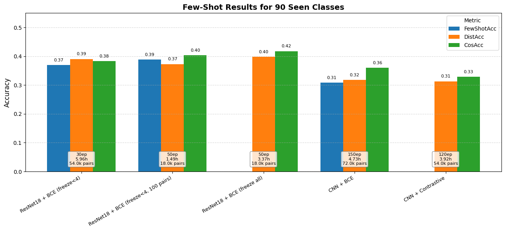

<details>
<summary>Results for 80 and 50 seen classes</summary>

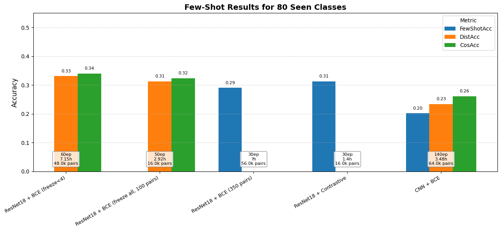
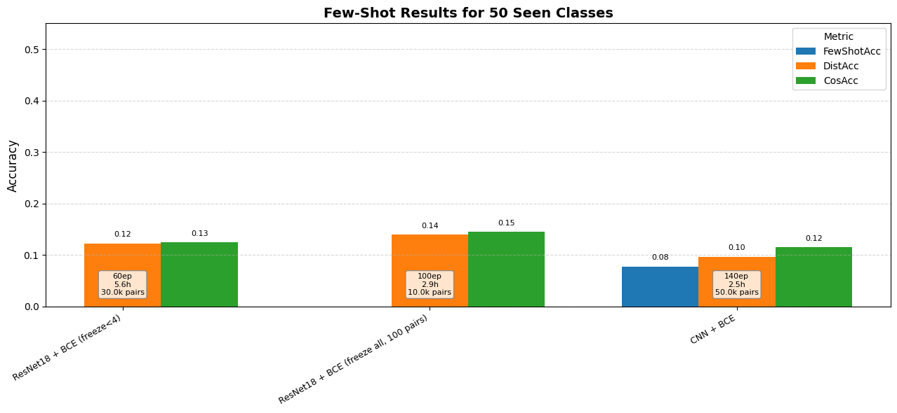

</details>

### 💡 Key findings
- **Transfer learning wins.** Pretrained ResNet-18 beat the CNN trained from scratch in every split (e.g. 34.0% vs 26.2% on 20-way).
- **Less fine-tuning generalises better.** A fully frozen backbone trained on only 100 pairs per class matched or beat fine-tuning `layer4` on 300 pairs (best on 10-way and 50-way, −1.6 points on 20-way), in a fraction of the training time (3.4 h vs 6 h). Fine-tuning more makes the features specialise on the seen classes.
- **Cosine similarity is the best way to compare embeddings**: it gave the highest accuracy in 10 of the 11 runs where all metrics were measured.
- **Verifying a pair is much easier than choosing among N.** The best models reach ~87% accuracy at "same / different?" on validation pairs, but one-shot accuracy drops as the number of candidate classes grows (10 → 50).
- **Contrastive loss did not beat BCE** in this setup.

---

## 🗂️ Project Structure

```
├── siamese/
│   ├── data_utils.py         # CIFAR-100 loading, seen/unseen split, pair generation, support/query sets
│   ├── models.py             # SiameseResNet (ResNet-18) and SiameseCNN
│   ├── train.py              # Training loop, early stopping, TensorBoard, contrastive loss
│   ├── evaluate.py           # One-shot evaluation: classifier head, Euclidean, cosine
│   └── helper_functions.py   # Visualisation of pairs, predictions and training curves
├── notebooks/
│   └── One_shot_learning_with_Cifar100_dataset.ipynb   # Full pipeline and all experiments
├── images/                   # Figures and results
├── runs/                     # TensorBoard logs
├── experiments.txt           # Raw experiment log
└── requirements.txt
```

---

## 🚀 Getting Started

The easiest way is to open the notebook in **Google Colab** (badge above) with a GPU runtime.

To run locally:
```bash
git clone https://github.com/bassemr/one-short-learning.git
cd one-short-learning
pip install -r requirements.txt
```

```python
import sys, torch
sys.path.append("siamese")
from data_utils import prepare_data
from models import SiameseResNet
from train import train
from evaluate import evaluate_fewshot_cosine

device = "cuda" if torch.cuda.is_available() else "cpu"

# 90 seen classes -> 10-way 1-shot test on the remaining 10 classes
train_loader, val_loader, support_loader, query_loader = prepare_data(
    root="data", num_training_classes=90,
    pos_num_pairs=100, neg_num_pairs=100, batch_size=64, img_size=224)

model = SiameseResNet().to(device)          # backbone frozen by default
# model.freeze_until(4)                     # optionally fine-tune layer4

optimizer = torch.optim.Adam(model.parameters(), lr=1e-3, weight_decay=1e-5)
loss_fn = torch.nn.BCEWithLogitsLoss()

history, model = train(model, train_loader, val_loader, optimizer, loss_fn,
                       device, epochs=50, patience=10)

evaluate_fewshot_cosine(model, support_loader, query_loader, device=device)
```

To view the training curves: `tensorboard --logdir runs`

---

## 🧪 Full Experiment Log

<details>
<summary>All 13 runs (click to expand)</summary>

Accuracies are one-shot accuracy on unseen classes. "—" = not measured.

| # | Model | Loss | Img | Seen | Pairs/class (+/−) | Train pairs | Best epoch | Val acc (pairs) | Head | Euclid. | Cosine | Time |
|---|---|---|:---:|:---:|:---:|:---:|:---:|:---:|:---:|:---:|:---:|:---:|
| 1.1 | ResNet-18, layer4 tuned | BCE | 224 | 90 | 300 / 300 | 53,979 | 25/30 | 86.3% | 36.9% | 39.1% | 38.3% | 5h 58m |
| 1.2 | ResNet-18, layer4 tuned | BCE | 224 | 80 | 300 / 300 | 47,985 | 28/60 | 86.6% | — | 33.1% | 34.0% | 7h 09m |
| 1.3 | ResNet-18, layer4 tuned | BCE | 224 | 50 | 300 / 300 | 29,984 | 32/60 | 88.1% | — | 12.3% | 12.5% | 5h 36m |
| 2.1 | ResNet-18, layer4 tuned | BCE | 224 | 90 | 100 / 100 | 17,998 | 12/50 | 72.5% | 38.9% | 37.3% | 40.3% | 1h 29m |
| 2.2 | ResNet-18, frozen | BCE | 224 | 90 | 100 / 100 | 17,998 | 43/50 | 75.4% | — | 39.8% | **41.8%** | 3h 23m |
| 2.3 | ResNet-18, frozen | BCE | 224 | 80 | 100 / 100 | 15,998 | 49/50 | 74.6% | — | 31.3% | 32.4% | 2h 55m |
| 2.4 | ResNet-18, frozen | BCE | 224 | 50 | 100 / 100 | 10,000 | 64/100 | 79.6% | — | 14.0% | **14.6%** | 2h 54m |
| 3.1 | CNN (scratch) | BCE | 32 | 90 | 400 / 400 | 71,956 | 84/150 | 77.4% | 30.8% | 31.8% | 36.0% | 4h 44m |
| 3.2 | CNN (scratch) | BCE | 32 | 80 | 400 / 400 | 63,967 | 76/140 | 75.6% | 20.3% | 23.4% | 26.2% | 3h 29m |
| 3.3 | CNN (scratch) | BCE | 32 | 50 | 500 / 500 | 49,963 | 69/140 | 79.4% | 7.8% | 9.7% | 11.5% | 2h 30m |
| 4 | ResNet-18 | BCE | 224 | 80 | 350 / 350 | 55,970 | 29/30 | 87.0% | 29.0% | — | — | — |
| 5.1 | ResNet-18 | Contrastive | 224 | 80 | 100 / 100 | 15,999 | 24/30 | 69.5% | 31.3%* | — | — | — |
| 5.2 | CNN (scratch) | Contrastive | 32 | 90 | 300 / 300 | 53,973 | 118/120 | 74.0% | — | 31.3% | 32.8% | — |

\* Nearest-embedding accuracy with the contrastive embeddings.

Full details for each run are in [`experiments.txt`](experiments.txt) and in the notebook.

</details>

<details>
<summary>Training curves</summary>

| Run | Curves |
|---|---|
| 1.1 | 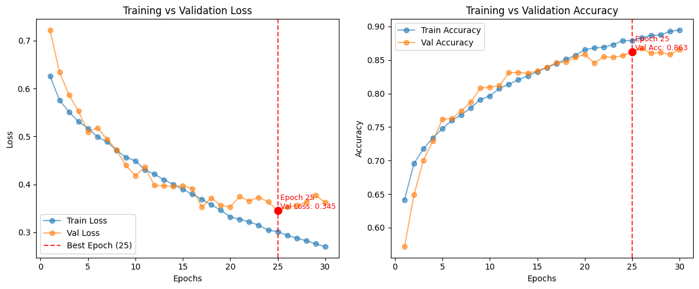 |
| 1.2 | 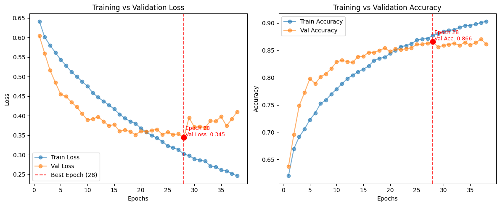 |
| 1.3 | 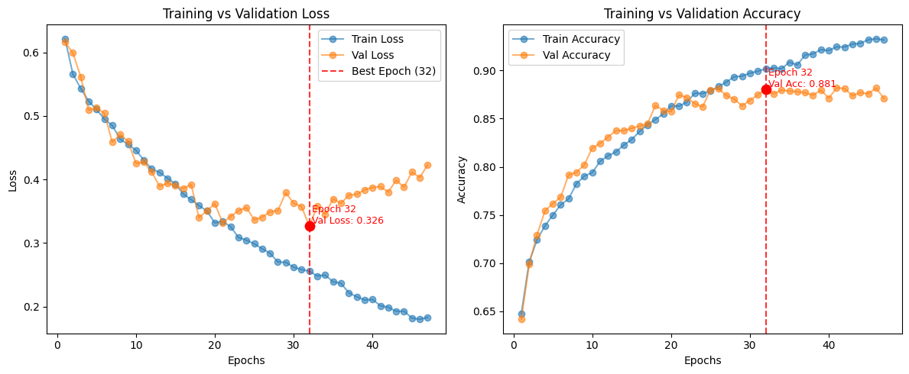 |
| 2.1 | 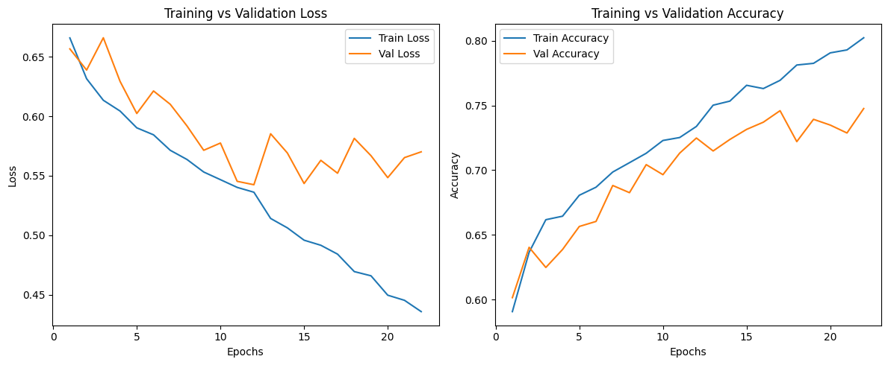 |
| 2.2 | 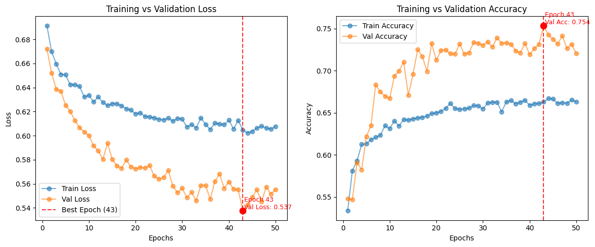 |
| 2.3 | 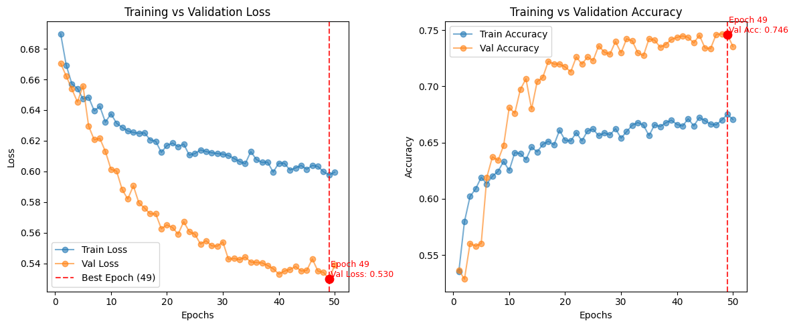 |
| 2.4 | 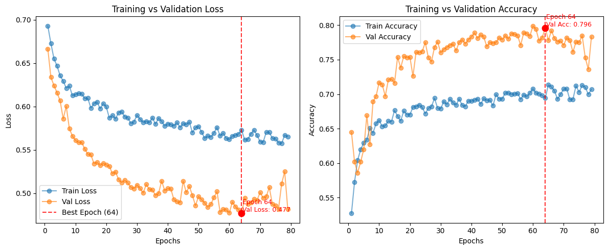 |
| 3.1 | 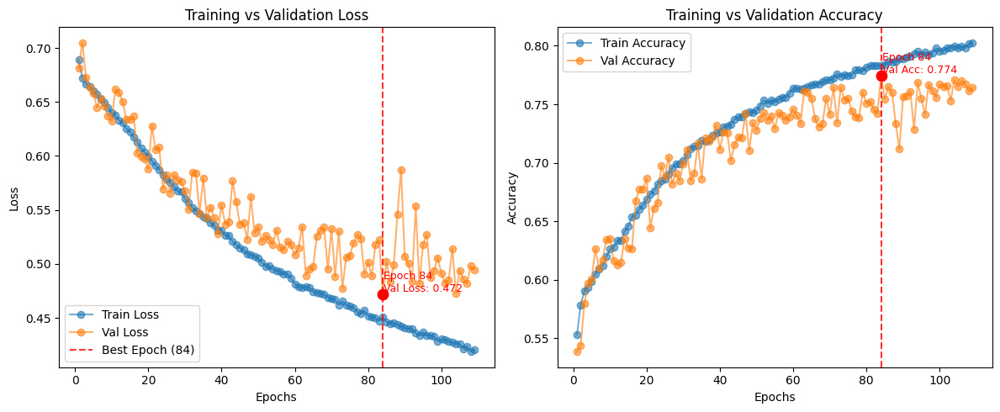 |
| 3.2 | 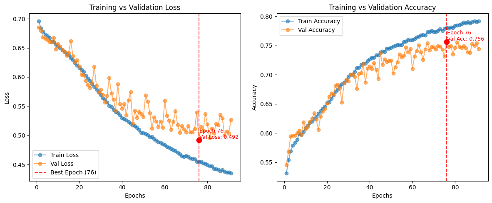 |
| 3.3 | 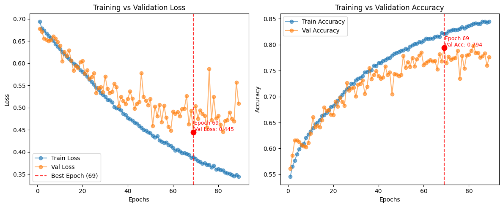 |
| 4 | 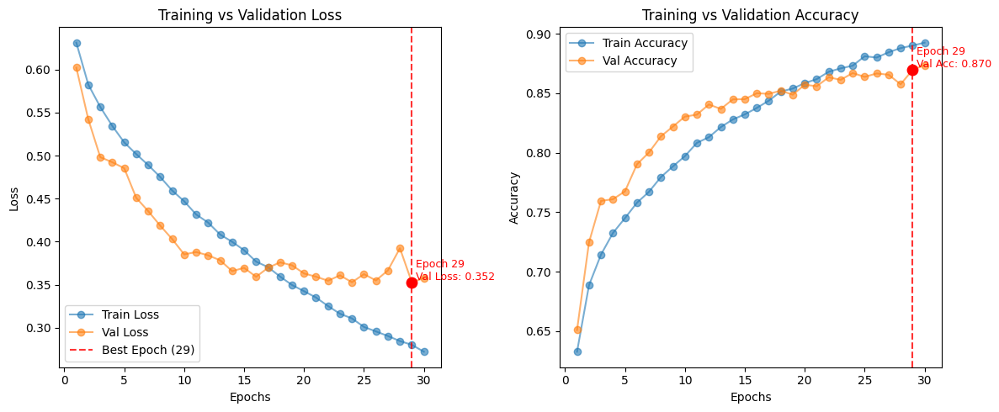 |
| 5.1 | 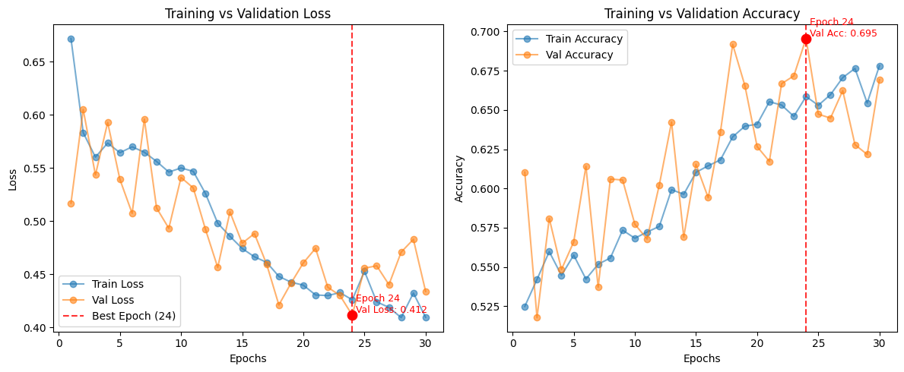 |

</details>

---

## 🔭 Possible Improvements
- Train with **triplet loss** or **prototypical networks**, which are designed for few-shot learning
- Use a stronger backbone (ResNet-50, ViT) or self-supervised features
- Report the mean ± std over several random seen/unseen splits and support sets

---

## 🛠️ Tech Stack


---

## 🎓 Skills & Concepts Applied

**Deep Learning & Computer Vision**
- **Convolutional Neural Networks (CNNs):** designed a 3-block CNN from scratch (convolution, batch normalization, ReLU, max pooling, fully connected layers, dropout)
- **ResNet-18 and transfer learning:** used ImageNet-pretrained weights, compared a frozen backbone with partial fine-tuning (`layer4`)
- **Siamese networks and metric learning:** shared-weight encoders that learn an embedding space where similar images are close
- **Few-shot / one-shot learning:** N-way 1-shot evaluation with support and query sets on classes never seen during training
- **Loss functions:** binary cross-entropy with logits and contrastive loss (implemented from scratch)
- **Similarity metrics:** Euclidean distance and cosine similarity between embeddings

**Training & Experimentation**
- Data augmentation (random crop, flip, rotation, color jitter) and normalization
- Balanced positive/negative pair generation and train/validation splitting by class
- Adam optimizer, weight decay, dropout and **early stopping** to control overfitting
- **GPU training** on Google Colab, with memory-safe batched evaluation (chunking to avoid out-of-memory errors)
- Experiment tracking with **TensorBoard** and a structured log of 13 runs
- Reading training curves to diagnose overfitting and comparing models fairly

**Software Engineering**
- Modular, reusable PyTorch code (separate data, model, training and evaluation modules)
- Custom `Dataset` and `DataLoader` classes
- Version control with Git and GitHub; reproducible runs with fixed random seeds

---

## 📚 References
- G. Koch, R. Zemel, R. Salakhutdinov — *Siamese Neural Networks for One-shot Image Recognition* (2015)
- R. Hadsell, S. Chopra, Y. LeCun — *Dimensionality Reduction by Learning an Invariant Mapping* (2006), contrastive loss
- [An Introduction to Few-Shot Learning](https://www.analyticsvidhya.com/blog/2021/05/an-introduction-to-few-shot-learning/)

---

## 👤 Author

**Bassem Kedis** — Computer Engineer, MSc in Artificial Intelligence (University of Parma)
[LinkedIn](https://www.linkedin.com/in/bassem-kedis-845649336/) · [GitHub](https://github.com/bassemr)
